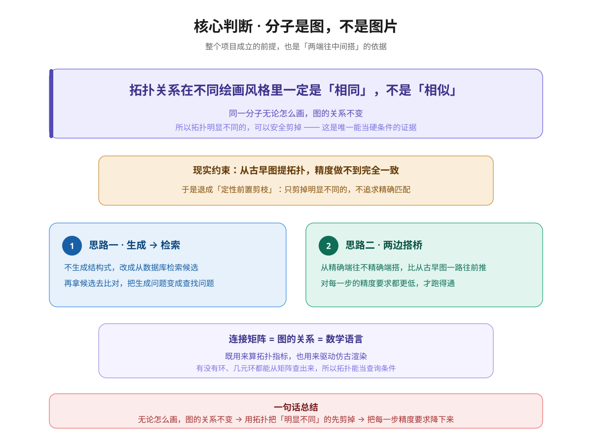
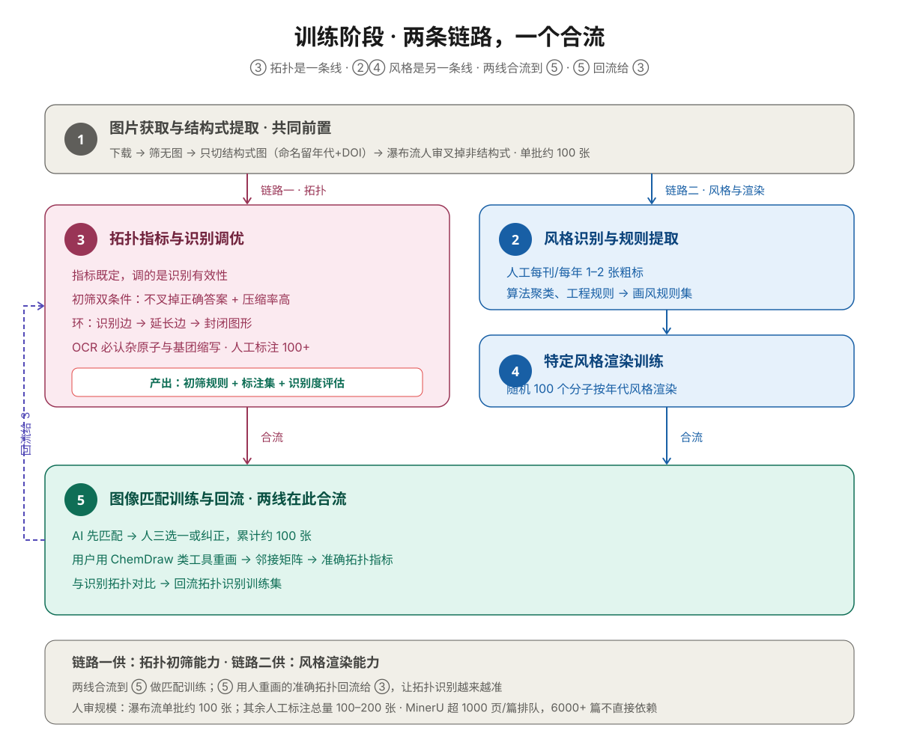
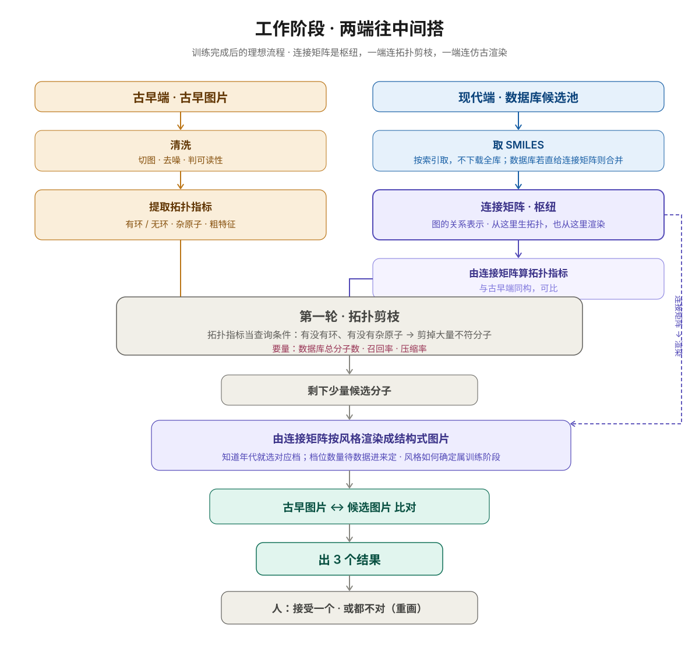

# CSD 项目思路图

> 用途：对外讲思路用。三张图分别说明**为什么这么做**、**训练阶段怎么做**、**工作阶段怎么跑**。
> 来源：2026-11-23 与用户的对话，按用户口述整理。术语按用户纠正：**拓扑剪枝**（减去枝条），不是「减脂」。
> 文件：`core-worldview.svg` / `train-stage.svg` / `work-stage.svg`。

---

## 一、核心世界观（为什么这么做）

**一句话**：分子是图，不是图片。拓扑关系在不同绘画风格里一定是**相同**，不是「相似」。

- 从古早图提拓扑做不到完全一致，所以退成**定性前置剪枝**——只剪掉明显不同的，不追求精确匹配。
- 两个思路：**生成 → 检索**（从数据库检索候选再比对）、**两边搭桥**（从精确端往不精确端搭，每步精度要求更低）。
- **连接矩阵**是枢纽：它等于图的关系，既算拓扑指标，也驱动仿古渲染；有没有环、几元环都能从矩阵查出来，所以拓扑能当查询条件。

---

## 二、训练阶段（现在要做的事）

**结构**：① 是共同前置，之后分两条链路——

- **链路一**：③ 拓扑指标与识别调优
- **链路二**：② 风格识别与规则提取 → ④ 特定风格渲染训练
- 两条链路**合流到 ⑤** 图像匹配训练；**⑤ 回流给 ③**，用人重画得到的准确拓扑增强识别。

拓扑初筛的双条件：**不叉掉正确答案** + **压缩率高**。人审规模：瀑布流单批约 100 张，其余标注总量 100–200 张。

---

## 三、工作阶段（训练完成后的理想流程）

**结构**：两端往中间搭——

- **古早端**：古早图片 → 清洗 → 提拓扑指标
- **现代端**：数据库候选池 → 取 SMILES（若数据库直给连接矩阵则合并）→ **连接矩阵（枢纽）** → 算拓扑指标
- 两端在**第一轮拓扑剪枝**汇合（拓扑指标当查询条件，剪掉大量不符分子；要量总分子数、召回率、压缩率）
- 剩少量候选 → **由连接矩阵按风格渲染**（虚线从连接矩阵过来）→ 古早图与候选图比对 → 出 3 个结果 → 人接受一个或都不对（重画）

---

## 四、两个阶段如何对接

| 训练阶段产出 | 工作阶段用在哪 |
|---|---|
| ① 干净结构式图集 | 古早端的输入 |
| ③ 拓扑初筛规则 | 两端汇合的拓扑剪枝 |
| ②④ 画风规则集 + 渲染能力 | 连接矩阵按风格渲染 |
| ⑤ 回流增强的拓扑识别 | 古早端提拓扑指标 |
| ③ 的识别度评估 / 双模式对照 | 决定是否从二值升级为精确 |
